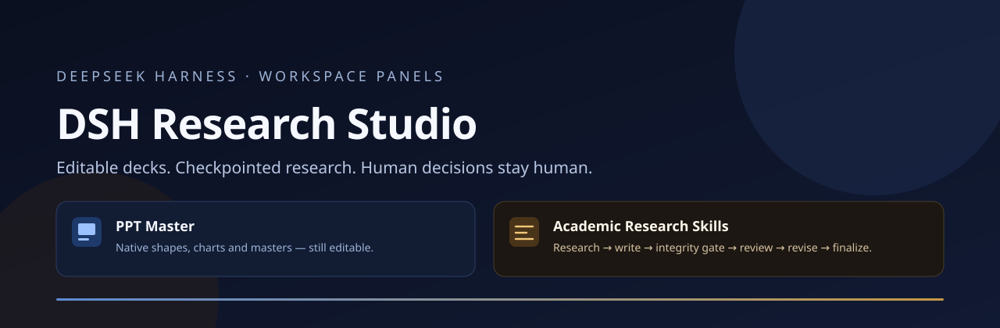
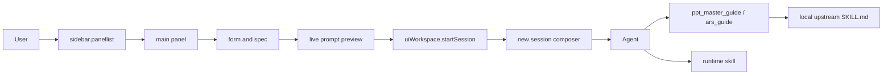

# DSH Research Studio

[简体中文](README.md) · English



**Two plugins, one repository, two workflows.** Two DeepSeek Harness (DSH) sidebar panels: one for presentations that stay editable, one for an academic research pipeline with mandatory integrity gates.


## What it is

| Panel | You provide | It delivers |
| --- | --- | --- |
| **PPT Master** | Source/topic, canvas, page count, pacing, route (free / template / edit native / distill / animate), chart mode, local repository path | A complete PPT Master prompt, placed in a new session composer; form memory and path checks |
| **Academic Research Skills** | Skill, mode, research target, language, citation style, paper structure, local repository path | A checkpointed ARS prompt with integrity gates, a six-stage overview, five skill groups, and an explicit integrity boundary |

Both panels share one boundary: **compose the prompt and provide the entry point; never pretend to execute.** Actual PPTX generation and the ARS pipeline run in your local upstream checkout, with your Python/Claude Code environment and the agent.

## Quick start

Requirements: a DSH build with client plugins, Node.js **22+** (Host/tests only; the panels have no build step and no third-party runtime dependencies), and optionally:

- PPT Master: <https://github.com/hugohe3/ppt-master> (Python 3.10–3.14 for real generation).
- Academic Research Skills: <https://github.com/Imbad0202/academic-research-skills>.

```bash
git clone https://github.com/y0u41/dsh-research-studio.git
cd dsh-research-studio
```

Install either package by pointing DSH's `plugin_manager` at the absolute package directory:

```text
plugin_manager: install_bundle, target: /absolute/path/to/dsh-research-studio/packages/ppt-master
plugin_manager: install_bundle, target: /absolute/path/to/dsh-research-studio/packages/academic-research-skills
```

Refresh the page. Each bundle is independently installable and can be disabled without the other.

> If you previously installed the local development versions from the old `plugins/` folder, disable or remove them first. Two bundles with the same `panelId` cause duplicate sidebar entries or panel-selection conflicts.

In the panel, fill the form, review the live prompt, then choose **Place in a new session**. The prompt lands in the composer; it is not sent automatically. If a local repository path is provided, the prompt asks the agent to call `ppt_master_guide` or `ars_guide` first.

## What it does not do

- It does not generate PPTX files, bundle PPT Master scripts, or install Python.
- It does not run ARS, bundle its Claude Code runtime, or verify experiments and data.
- It does not fabricate execution results, citations, or sources.
- It does not upload data: no `fetch`, no telemetry, no remote storage; the form uses browser `localStorage` only.
- It does not replace human judgement: the research question, method, interpretation, and conclusions remain yours.

## Architecture



Each package has a Host half (`index.js`: read-only guide tool and runtime skill) and a Client half (`client.js`: sidebar entry, panel, form, preview, styles, bilingual copy).

See [architecture](docs/architecture.md), [contracts](docs/contracts.md), and the [ADRs](docs/adr/).

## Quality

```bash
npm test
```

This runs the repository contract suite, both render smoke tests, both host smoke tests, and `node --check` over all JavaScript. See [quality and testing](docs/quality-and-testing.md) and [acceptance](docs/acceptance.md).

## Status

Version **1.0.0**, distributed as source via GitHub (once published); not published to npm. The DSH client plugin API is still evolving; the panels depend on `sidebar.panellist`, `main`, `ctx.locale`, `ctx.slots`, `ctx.uiWorkspace`, `ctx.tools`, and `ctx.skills`. Browser E2E and upstream execution tests are not included.

## Publishing to GitHub

The repository is published at <https://github.com/y0u41/dsh-research-studio>. The commands below are only for rebuilding from scratch or migrating to a new account/organization:

```bash
# 1. Create an empty GitHub repository (no README/LICENSE)
# 2. The repository URL is prefilled for the y0u41 account; replace it if you move to an organization
git init -b main
git add -A
git commit -m "feat: initial DSH Research Studio"
git remote add origin https://github.com/y0u41/dsh-research-studio.git
git push -u origin main
```

Before pushing, confirm the repository URL matches the `y0u41` account (or your organization); make sure CI passes on Node 22/24; enable private vulnerability reporting; and confirm no secrets or private paths are committed. Then follow [release](docs/release.md) to tag `v1.0.0`.

## Attribution and licenses

This is **not** an official PPT Master or Academic Research Skills project and implies no upstream endorsement.

| Part | License | Note |
| --- | --- | --- |
| Original repository code and docs | MIT | See [LICENSE](LICENSE) |
| `packages/ppt-master` | MIT | Includes upstream MIT notice; upstream: Hugo He |
| `packages/academic-research-skills` | CC BY-NC 4.0 | Adapts the upstream workflow structure; upstream: Cheng-I Wu; **non-commercial** |
| Upstream PPT Master | MIT | <https://github.com/hugohe3/ppt-master> |
| Upstream Academic Research Skills | CC BY-NC 4.0 | <https://github.com/Imbad0202/academic-research-skills> |

See [ATTRIBUTION.md](ATTRIBUTION.md) and [NOTICE](NOTICE). The root MIT license does not override the CC BY-NC 4.0 terms of the ARS package.

## Contributing

[CONTRIBUTING.md](CONTRIBUTING.md) · [SECURITY.md](SECURITY.md) · [CODE_OF_CONDUCT.md](CODE_OF_CONDUCT.md) · [CHANGELOG.md](CHANGELOG.md)
