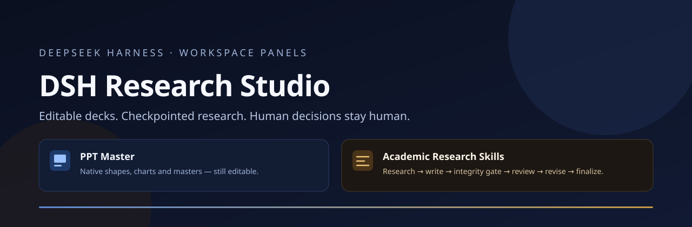
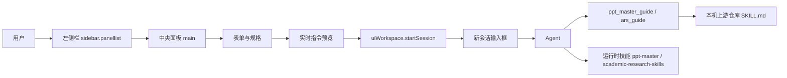

# DSH Research Studio

[English](README.en.md) · 简体中文



**两个插件，一个仓库，两种工作流。** 把「做一份还能改的演示文稿」和「跑一条有完整性闸门的学术研究流水线」做成 DeepSeek Harness 左侧栏里的两个工作台面板。


---

## 这是什么

| 面板 | 你填什么 | 它交付什么 |
| --- | --- | --- |
| **PPT Master** | 素材/主题、画布、页数、节奏、路线（自由设计 / 套用模板 / 填充已有 PPTX / 蒸馏模板 / 加动效解说）、图表方式、本机仓库路径 | 一条可直接发送的 PPT Master 工作流指令；新建会话并放进输入框；表单记忆、路径校验 |
| **Academic Research Skills** | 技能、模式、研究对象、语言、引用格式、论文结构、本机仓库路径 | 一条带检查点与完整性闸门的 ARS 指令；6 阶段流水线一览；5 套技能与 33 个单技能模式；完整性边界说明 |

两个面板都坚持同一个边界：**只组装指令和提供入口，不假装执行。** 真正的 PPTX 生成和 ARS 流水线由你本机的上游仓库、Python/Claude Code 环境和 agent 完成。

## 为什么需要它

通用聊天窗口很容易漏掉这些约束：画布尺寸、页数、模板继承、原生图表、引用格式、审稿轮次、完整性闸门、人工确认点。漏掉一次，后面就要返工。

这个项目把「一次说清楚」变成可复用的表单：

- **结构化**：把散落在 README、SKILL.md 和团队约定里的规格变成可见字段。
- **可预览**：发送前能看到完整指令，不是盲盒。
- **可停止**：先放入输入框，不自动发送；你可以改完再发。
- **可追溯**：本机路径、上游版本与许可证都写在明处。

## 快速开始

### 1. 准备

- 一个支持客户端插件的 DeepSeek Harness（DSH）环境。
- Node.js **22+**（仅用于 Host 代码与测试；面板本身无构建步骤、无第三方运行时依赖）。
- 可选的上游仓库：
  - PPT Master：<https://github.com/hugohe3/ppt-master>，另需 Python 3.10–3.14。
  - Academic Research Skills：<https://github.com/Imbad0202/academic-research-skills>。

### 2. 克隆

```bash
git clone https://github.com/y0u41/dsh-research-studio.git
cd dsh-research-studio
```

> 仓库已发布到 <https://github.com/y0u41/dsh-research-studio>；如果迁移到组织，把 `y0u41` 统一替换并更新远程地址。

### 3. 安装一个或两个面板

在 DSH 会话里让 agent 调用 `plugin_manager`，`target` 指向**绝对路径**：

```text
plugin_manager: install_bundle, target: /absolute/path/to/dsh-research-studio/packages/ppt-master
plugin_manager: install_bundle, target: /absolute/path/to/dsh-research-studio/packages/academic-research-skills
```

安装后刷新页面。左侧栏会出现两个入口：**PPT Master**（演示文稿图标）与 **学术研究**（文稿图标）。两个 bundle 可以单独安装、单独禁用。

> 如果你之前装过本地开发版（旧的 `plugins/` 目录包），请先禁用/移除旧 bundle，再安装本仓库版本。同一个 `panelId` 同时存在会造成侧栏重复或面板选择冲突。

### 4. 用起来

1. 点左侧栏入口，中央面板打开。
2. 填素材/研究对象与规格；右侧实时预览指令。
3. 点「填入新会话」：新会话打开，指令在输入框里，**不会自动发送**。
4. 检查、修改、发送。
5. 若填了本机仓库路径，指令会要求 agent 先调用 `ppt_master_guide` / `ars_guide` 读取真实 `SKILL.md`。

## 它不做什么

- **不生成 PPTX**：不包含 PPT Master 的脚本、模板或 Python 依赖。
- **不运行 ARS**：不包含 ARS 的 Claude Code 运行时、技能文件或审稿 agent。
- **不伪造执行结果**：仓库缺失时，指令要求 agent 说明缺什么，而不是声称已经跑过。
- **不上传数据**：面板没有 `fetch`、没有遥测、没有远程存储；表单只写浏览器 `localStorage`。
- **不替你做研究判断**：ARS 的完整性闸门检查引用存在性、引用与论断对齐、方法报告、图表与报告规范；它**不能证明**实验真的做过、原始数据真实、结果可复现。研究问题、方法选择、数据解释与最终结论仍由人负责。

## 架构一览



每个包都分成两半：

| 半边 | 文件 | 职责 |
| --- | --- | --- |
| Host | `index.js` | 注册只读 guide 工具与运行时技能；有界读取 `SKILL.md`；不执行上游脚本 |
| Client | `client.js` | 注册侧栏入口与主面板；表单、校验、预览、复制、新建会话；全部样式与中英文案 |

详细设计见 [架构与代码层](docs/architecture.md)，契约见 [契约](docs/contracts.md)。

## 文档地图

| 层 | 文档 | 回答什么 |
| --- | --- | --- |
| 业务与交付 | [docs/business-and-delivery.md](docs/business-and-delivery.md) | 为谁做、交付什么、不交付什么、如何算完成 |
| 架构与代码 | [docs/architecture.md](docs/architecture.md) | Host/Client 分工、slot、数据流、目录结构 |
| 质量与测试 | [docs/quality-and-testing.md](docs/quality-and-testing.md) | 测了什么、怎么测、哪里没测 |
| 横切底座 | [docs/cross-cutting.md](docs/cross-cutting.md) | 安全、隐私、权限、可访问性、国际化、性能 |
| 红线 | [docs/red-lines.md](docs/red-lines.md) | 绝不做的事与越线处理 |
| 设计系统 | [docs/design-system.md](docs/design-system.md) | token、布局、组件、文案语气 |
| 契约 | [docs/contracts.md](docs/contracts.md) | 包名、id、schema、双语、版本规则 |
| 发布 | [docs/release.md](docs/release.md) | 版本、检查、GitHub Release 流程 |
| 验收 | [docs/acceptance.md](docs/acceptance.md) | 实际执行过的验收矩阵与未覆盖项 |
| 决策记录 | [docs/adr/](docs/adr/) | 为什么这样分层、为什么不共享运行时 |

## 质量与测试

```bash
npm test
```

一条命令跑完：

- 仓库契约测试（包清单、bundle patch、双语文案、slot 顺序、主题 token、Host 工具 schema、许可证与文档链接）。
- 两个面板的渲染冒烟测试（VM 加载 `client.js`，真实调用 `apply`，渲染中文界面）。
- 两个 Host 半边的测试（技能注册、工具 schema、guide 读取、空路径、缺失路径、超长截断）。
- 所有 JS 文件的 `node --check` 语法检查。

当前结果与未覆盖项见 [质量与测试层](docs/quality-and-testing.md) 和 [验收记录](docs/acceptance.md)。

## 仓库地图

```text
.
├── packages/
│   ├── ppt-master/                 # @dsh-research-studio/ppt-master (MIT)
│   └── academic-research-skills/   # @dsh-research-studio/academic-research-skills (CC BY-NC 4.0)
├── docs/
│   ├── business-and-delivery.md    # 业务与交付层
│   ├── architecture.md             # 架构与代码层
│   ├── quality-and-testing.md      # 质量与测试层
│   ├── cross-cutting.md            # 横切底座
│   ├── red-lines.md                # 红线
│   ├── design-system.md            # 视觉与交互规范
│   ├── contracts.md                # 跨包契约
│   ├── release.md                  # 发布流程
│   ├── acceptance.md               # 验收矩阵与记录
│   └── adr/                        # 架构决策记录
├── tests/repo.test.mjs             # 仓库级契约测试
├── scripts/verify.mjs              # 一键验证
├── assets/banner.svg
├── ATTRIBUTION.md                  # 上游来源与使用范围
├── NOTICE
├── LICENSE                         # 根仓库 MIT
└── LICENSES/CC-BY-NC-4.0.txt
```

## 状态与兼容性

- 版本：**1.0.0**，面向 GitHub 源码分发；不发布到 npm。
- DSH 客户端插件 API 仍在演进。本项目依赖已公开的 `sidebar.panellist`、`main`、`ctx.locale`、`ctx.slots`、`ctx.uiWorkspace`、`ctx.tools`、`ctx.skills` 契约；上游若改动，面板需要跟随。
- 已通过 VM 渲染冒烟、Host 冒烟、契约测试与语法检查；**尚未**在真实 DSH profile 中安装本仓库重命名后的包，也未做浏览器 E2E。安装与页面验收步骤见 [验收记录](docs/acceptance.md)。
- 两个包都声明 `private: true`，避免误发布到 npm。

## 发布到 GitHub

仓库已发布到 GitHub。以下命令仅用于从零重建或迁移到新账号/组织：

```bash
# 1. 在 GitHub 创建一个空仓库（不要勾选 README/LICENSE）
# 2. 仓库地址已按账号 y0u41 预填；如改用组织请统一替换
git init -b main
git add -A
git commit -m "feat: initial DSH Research Studio"
git remote add origin https://github.com/y0u41/dsh-research-studio.git
git push -u origin main
```

推送前：

- [ ] 确认仓库地址与账号 `y0u41` 一致（或已替换为你的组织）。
- [ ] 确认 `.github/workflows/ci.yml` 在 Actions 里跑通（Node 22/24）。
- [ ] 在仓库 Settings → Security 打开 **Private vulnerability reporting**。
- [ ] 确认没有提交 `.env`、token、个人绝对路径或未公开数据。
- [ ] CI 绿后按 [发布流程](docs/release.md) 打 `v1.0.0` tag 并创建 Release。

## 来源与许可

本项目**不是** PPT Master 或 Academic Research Skills 的官方项目，也不代表上游背书。

| 部分 | 许可证 | 说明 |
| --- | --- | --- |
| 本仓库原创代码与文档 | MIT | 见 [LICENSE](LICENSE) |
| `packages/ppt-master` | MIT | 含上游 MIT 版权声明；上游：Hugo He |
| `packages/academic-research-skills` | CC BY-NC 4.0 | 含对上游工作流结构的改编；上游：Cheng-I Wu；**禁止商业使用** |
| 上游 PPT Master | MIT | <https://github.com/hugohe3/ppt-master> |
| 上游 Academic Research Skills | CC BY-NC 4.0 | <https://github.com/Imbad0202/academic-research-skills> |

完整说明见 [ATTRIBUTION.md](ATTRIBUTION.md) 与 [NOTICE](NOTICE)。如果你要商业使用 ARS 面板，请先获得上游权利人的单独许可；根仓库的 MIT 许可不覆盖该包。

## 参与

- 贡献指南：[CONTRIBUTING.md](CONTRIBUTING.md)
- 安全问题：[SECURITY.md](SECURITY.md)
- 行为准则：[CODE_OF_CONDUCT.md](CODE_OF_CONDUCT.md)
- 变更记录：[CHANGELOG.md](CHANGELOG.md)

## English

A short English overview lives in [README.en.md](README.en.md). The detailed layer documents are currently Chinese-first; the code, UI strings, and contracts are bilingual.
