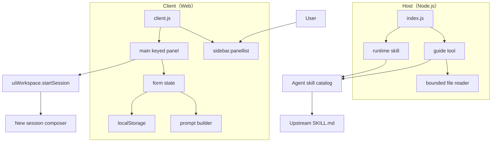
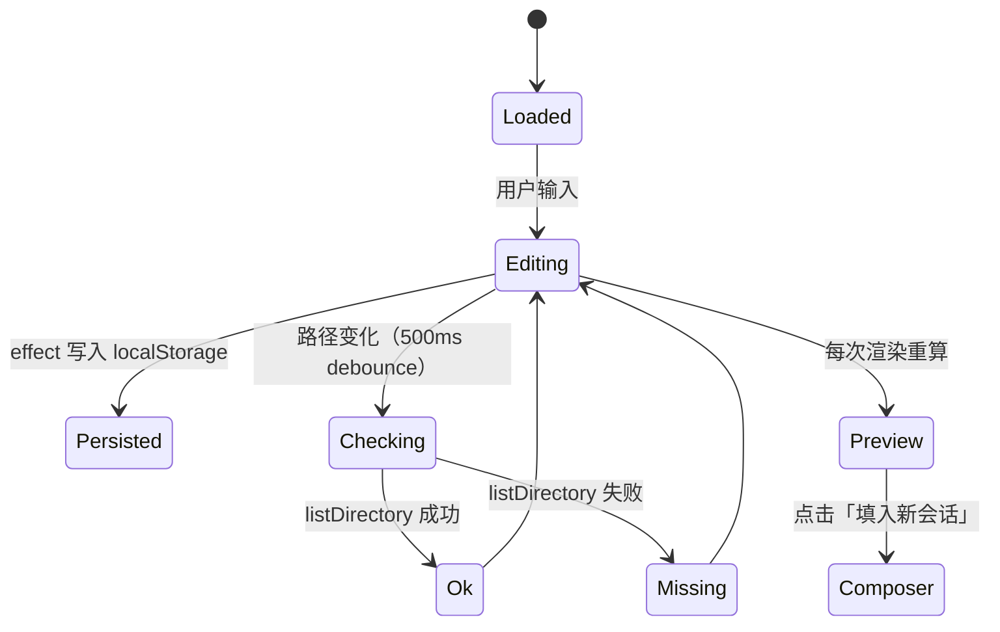

# 架构与代码层

> 这一层回答：**代码怎么分层、运行时怎么加载、状态怎么流动、为什么这样拆分。**
> 业务边界见 [业务与交付层](business-and-delivery.md)；跨包不变量见 [契约](contracts.md)。

## 1. 总览

每个插件包都由 **Host 半边**与 **Client 半边**组成，二者运行在不同上下文，只通过 DSH 的公开契约协作。



### 为什么是两半边

- **Host** 能读本机文件、注册工具与技能；它不应该碰 DOM。
- **Client** 能渲染 UI、访问 `localStorage`、调用工作区 API；它不应该读任意本机文件。
- 两边都只依赖 DSH 的公开接口，不互相 import，不共享模块实例。

## 2. 仓库布局

```text
packages/<name>/
├── package.json          # dsh.bundle.patch + dsh.client + exports
├── cordis.patch.yml      # bundle 插入一行
├── index.js              # Host：工具 + 技能
├── client.js             # Client：侧栏 + 主面板
├── locale/{zh,en}.json   # 包元数据文案（标题/描述）
├── icon.svg              # 侧栏图标，currentColor
├── README.md             # 包级安装与边界
├── LICENSE               # 包级许可证
└── test/
    ├── render-smoke.mjs  # VM 加载 client.js，渲染并断言
    └── host-smoke.mjs    # 真实调用 Host 注册与 guide
```

根目录只放**跨包**内容：工作区清单、契约测试、五层文档、许可证与来源、CI。

## 3. 加载与注册

### 3.1 Bundle patch

`cordis.patch.yml` 只做一件事：把包插入 DSH 的插件行。

```yaml
- insert:
    - id: ppt-master
      name: '@dsh-research-studio/ppt-master'
```

`package.json` 同时声明：

```json
{
  "dsh": {
    "bundle": { "patch": "./cordis.patch.yml" },
    "client": {
      "platform": "web",
      "immediately": true,
      "inject": ["layout", "sidebar", "workspace"]
    }
  }
}
```

- `immediately: true`：客户端 bundle 在页面加载时注册，不等待用户打开面板。
- `inject`：声明客户端需要的服务；缺少时 DSH 会阻止加载并报错，而不是半初始化。

### 3.2 Client 模块

`client.js` 不是 ESM，也不是打包产物；它通过 DSH 的模块加载器注册：

```js
window.__ModuleLoader__.load({
  id: '@dsh-research-studio/ppt-master',
  factory(require) {
    const React = require('react');
    const h = React.createElement;
    // ...
    return { apply };
  },
});
```

`apply(ctx)` 做四件事，顺序固定：

1. `ctx.locale.register(NS, { zh, en })`。
2. 注入一个 `<style data-plugin-css="...">`（只注入一次）。
3. `ctx.slots.inject('sidebar.panellist', () => ctx.slots.register(...))`，返回带 `id/order/label` 的条目。
4. `ctx.slots.inject('main', () => ctx.slots.register({ key: PANEL_ID, ... }))`。

`main` 是**按 key 取用**的 slot：侧栏条目 id 必须与主面板 key 相同，否则 `ctx.layout.selectPanel(id)` 找不到面板。两个包分别使用 `ppt-master` 与 `ars`。

### 3.3 Host 注册

`index.js` 导出：

```js
export const inject = ['tools', 'skills'];
export function apply(ctx) { /* ... */ }
```

在同一 `ctx.effect(() => { ... })` 中注册工具与技能，确保插件禁用时一起释放：

- `ctx.tools.register(name, schema, renderer)`：只读 guide 工具。
- `ctx.skills.register({ name, description, whenToUse, source, content })`：运行时技能。

工具的输出 schema 必须在**对象层**声明必填：

```js
output: {
  schema: {
    type: 'object',
    properties: { text: { type: 'string' } },
    required: ['text'],
  },
}
```

不能写成 `properties.text.required: true`；DSH 的 schema 校验会拒绝，并报：

```text
JsonSchemaError: unsupported JSON schema: schema.properties.text.required is not supported on type "string"
```

这是本项目踩过的真实坑，已写进 Host 冒烟测试。

## 4. 数据流

### 4.1 表单状态



- **初始值**：模块级 `SAVED` 在加载时读取一次，做字段校验；损坏数据回退默认值。
- **持久化**：每个字段变化后写入 `STORAGE_KEY`；`try/catch` 吞掉配额/隐私模式错误，不阻塞 UI。
- **路径校验**：`checkDirectory(path)` → `ctx.uiWorkspace.listDirectory(path).then(() => true, () => false)`。只证明**可读**，不证明可执行、不是文件、不是空目录。
- **预览**：`buildPrompt(t, values)` 是纯函数；不读外部状态，不做 I/O，便于测试。

### 4.2 新建会话

```js
startSession: (prompt) =>
  ctx.uiWorkspace.startSession(undefined, {
    prompt,
    clearPreviousDraft: true,
  })
```

语义：

- 打开一个新会话。
- 把 `prompt` 放进输入框。
- **不自动发送**。
- `clearPreviousDraft: true` 避免上一次草稿覆盖本次指令。

这是本项目最重要的交互边界：面板是**入口**，不是执行器。

### 4.3 Guide 工具有界读取

`readGuideHead(file)` 不整文件读入：

1. `open(file, 'r')`。
2. 分配 `MAX_GUIDE_CHARS * 4` 字节（UTF-8 上界）。
3. `read` 一次，取前缀。
4. 按字符截断到 12,000，超出时追加 `\n\n[truncated]`。
5. `finally` 关闭文件句柄。

这样即使 `SKILL.md` 很大，也不会把整个文件读进内存再截断。代价是：截断后的内容可能停在代码块/段落中间；工具会在文本末尾明确标记 `[truncated]`，不假装完整。

## 5. 关键模块

### 5.1 `buildPrompt`

纯函数，输入 `t`（翻译函数）与 `values`（表单值），输出最终指令字符串。结构固定：

```text
Build a presentation with the PPT Master workflow.
- If the skill catalog lists ppt-master, load it before starting.

Source material and topic:
...

Production spec:
- Canvas: ...
- Length: ...
- Pacing: ...
- Route: ...
- Charts and tables: ...

Output requirements:
1. ...
```

ARS 版本同构，但包含技能/模式/语言/引用格式/结构/检查点/完整性闸门。

**为什么把约束写进 prompt，而不是只放在 UI 文案里**：最终进入模型的是 prompt；UI 文案不会跟随会话。

### 5.2 组件树

```text
Panel
├── Hero（标题、简介、主 CTA、装饰 SVG）
├── StepRail（3 步 / 6 阶段）
├── BuilderCard
│   ├── Form（左）
│   └── Preview（右，sticky）
├── FeatureGrid（PPT）/ SkillGrid（ARS）
├── IntegrityBand（仅 ARS）
└── Footer（上游链接、许可、版本）
```

- 无外部 UI 库；只用 `React.createElement`。
- 所有颜色/边框/状态色走 `--dsw-alias-*` token；装饰 SVG 自带调色板。
- 断点：880px 单列、640px 紧凑；`prefers-reduced-motion` 去掉过渡。

### 5.3 文案

- 包元数据文案在 `locale/{zh,en}.json`。
- 面板文案在 `client.js` 的 `zh` / `en` 字典。
- `t(key, vars)` 做 `{name}` 插值；缺 key 时回退 key 本身，并在测试中检查双语 key 对齐。

## 6. 架构决策

| 决策 | 选择 | 理由 | 记录 |
| --- | --- | --- | --- |
| 仓库形态 | 一个仓库、两个独立包 | 共享治理与发布，不强迫同时安装 | [ADR-0001](adr/0001-monorepo-two-packages.md) |
| 运行时共享 | 不引入共享运行时包 | DSH client bundle 独立加载；共享包会增加安装耦合 | [ADR-0002](adr/0002-no-runtime-shared-dependency.md) |
| 执行边界 | 只组装 prompt，不执行上游 | 权限、可解释性、可停止；避免假装执行 | [ADR-0003](adr/0003-prompt-composer-boundary.md) |
| 状态 | 浏览器 `localStorage` | 无 Host 配置 API 时的最小可用方案；本机优先 | [ADR-0004](adr/0004-local-first-persistence.md) |
| 许可 | 根/PPT MIT，ARS CC BY-NC 4.0 | 尊重上游；不把非商业内容洗成 MIT | [ADR-0005](adr/0005-mixed-licensing.md) |

## 7. 失败模式

| 现象 | 可能原因 | 处理 |
| --- | --- | --- |
| 侧栏没有入口 | bundle 未安装/未启用；客户端未刷新 | 检查插件行；刷新页面 |
| 点入口没反应 | `main` key 与侧栏 id 不一致 | 检查两处 id；契约测试会拦 |
| 面板样式错乱 | 主题 token 缺失；自定义 skin 覆盖 | 切回默认主题；检查 `--dsw-alias-*` |
| guide 返回缺失 | 路径不含候选 `SKILL.md`；权限不足 | 用面板的文件夹选择器；确认文件存在 |
| 工具 schema 报错 | `required` 写在属性层 | 改为对象层 `required: ['text']` |
| 表单没记住 | 隐私模式/配额；`localStorage` 被清 | 属预期降级；不阻塞使用 |
| 路径显示 ok 但跑不了 | `listDirectory` 只证明可读 | 文档明确；由 agent 进一步验证环境 |

## 8. 扩展点

- **新增字段**：表单 → `values` → `buildPrompt` → 双语 key → 渲染断言。不要只改 UI。
- **新增面板**：复制包结构，换 `id`/`order`/`STORAGE_KEY`/模块 id；在根契约测试注册。
- **新增 Host 工具**：保持只读、对象层 `required`、有界读取、缺失路径可解释。
- **换持久化**：实现 `load/save` 适配器，保持 `STORAGE_KEY` 迁移路径；见 ADR-0004。

## 9. 性能与体积

- 两个 client 均约 46–57 KB 源码，无第三方运行时依赖，无构建步骤。
- 唯一的重活是渲染时的字符串拼接与一次 `localStorage` 读写；路径检查有 500ms debounce。
- 侧栏图标是内联 SVG，不发起网络请求。
- Host 读取上限 12,000 字符，避免大文件进入上下文。

## 10. 相关文档

- [契约](contracts.md)：跨包不变量与测试映射
- [设计系统](design-system.md)：token、布局、交互
- [质量与测试](quality-and-testing.md)：测试金字塔与覆盖缺口
- [横切底座](cross-cutting.md)：国际化、可访问性、隐私、可观测性
- [红线](red-lines.md)：不可越过的边界
