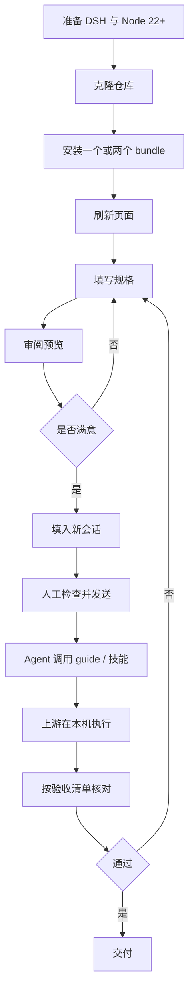

# 业务与交付层

> 这一层回答：**谁在什么场景下用它、它交付什么、怎么交付、失败时怎么收场。**
> 它不描述内部实现；实现见 [架构与代码层](architecture.md)。

## 1. 业务问题

两个上游项目都很强，但都要求使用者一次说清大量专业约束：

- **PPT Master** 需要画布、页数、模板、版式继承、图表方式、输出路径、是否保留母版等规格。漏一项，往往在生成后才发现，返工成本高。
- **Academic Research Skills（ARS）** 有 5 套技能、33 个单技能模式、10 个流水线阶段和 2 个强制完整性闸门。第一次使用时，用户很难记住当前该在哪个阶段、哪些确认点不能跳过。

通用聊天输入框不会替用户记住这些。结果是：**上游能力很强，但首次交付的确定性很低。**

本项目把「一次说清」变成可复用、可预览、可停止的表单，并把上游的边界写进指令本身。

## 2. 目标用户

| 画像 | 场景 | 最在意 |
| --- | --- | --- |
| 研究者 / 研究生 | 组会、开题、投稿前的文献与论文工作 | 引用不能编、阶段不能跳、完整性闸门不能省 |
| 教师 / 讲师 | 课程课件、讲义转演示文稿 | 输出能改、模板能继承、图表不是图片 |
| 咨询 / 产品 / 运营 | 汇报、方案、发布会材料 | 快速得到结构，且后续能自己改 |
| 工具型用户 | 已装 DSH，想把常用工作流固化 | 一次配置、侧栏即用、不污染全局 |

## 3. 价值主张与非目标

### 价值主张

1. **把隐性规格显性化**：所有关键字段在面板上可见、可改、可记忆。
2. **发送前可审阅**：完整指令实时预览，复制或放入新会话，不自动发送。
3. **把上游边界写进交付物**：不伪造执行、不伪造引用、不跳过闸门。
4. **本机优先**：不上传素材，不引入远程服务，不采集遥测。

### 非目标

- 不做 PPTX 生成器，不替代 PPT Master 的 Python 工具链。
- 不做 ARS 运行时，不替代 Claude Code / 上游技能。
- 不做论文代写，不替用户选择研究问题、方法或结论。
- 不做云端协作、账号体系、计费或团队权限。
- 不承诺「一键得到可投稿论文」或「一键得到可发布 PPT」。

## 4. 交付物清单

| 交付物 | 形态 | 验收标准 |
| --- | --- | --- |
| PPT Master 面板 | DSH client bundle + Host 插件 | 侧栏入口出现；表单可填；预览含全部已选规格；可填入新会话；刷新后表单保留 |
| ARS 面板 | DSH client bundle + Host 插件 | 侧栏入口出现；5 套技能/33 个模式可选；6 阶段可见；完整性边界可见；可填入新会话 |
| 运行时技能 | `ppt-master` / `academic-research-skills` | 技能目录可见；加载后返回完整 `<skill_content>` |
| 只读 guide 工具 | `ppt_master_guide` / `ars_guide` | 有路径时返回 `SKILL.md` 前 12,000 字符；缺失时返回可操作的说明 |
| 源码与文档 | GitHub 仓库 | `npm test` 通过；五层文档与许可证齐全；链接可解析 |
| 发布物 | Git tag / GitHub Release | 版本号、变更记录、许可证与来源一致 |

## 5. 交付流程



### 5.1 安装

```text
plugin_manager: install_bundle, target: <repo>/packages/ppt-master
plugin_manager: install_bundle, target: <repo>/packages/academic-research-skills
```

要求：

- `target` 必须是**绝对路径**，指向包含 `package.json` 的包目录。
- 安装后刷新页面；客户端 bundle 不会热更新已打开的旧页面。
- 两个包可独立安装、独立禁用；禁用其中一个不影响另一个。

### 5.2 首次使用

1. 在左侧栏选择面板。
2. 填最少必需项：PPT 的素材/主题；ARS 的研究对象。
3. 可选：填本机上游仓库路径。面板会检查路径是否可读；**可读不等于可执行**。
4. 审阅右侧预览。预览是最终发送内容，不是摘要。
5. 点「填入新会话」。指令进入输入框，不自动发送。
6. 人工检查后发送。

### 5.3 结果验收

**PPT Master**

- [ ] 叙述主线先用 3–5 句话说明。
- [ ] 页面内容优先，未编造数据；缺失事实已标注假设。
- [ ] `.pptx` 已导出；形状、文本、图表仍可编辑。
- [ ] 套用模板时保留母版与版式继承。
- [ ] 给出文件路径与每页一句话要点。

**ARS**

- [ ] 当前阶段与下一个检查点明确。
- [ ] 阶段 2.5 / 4.5 的完整性闸门未被跳过。
- [ ] 引用可核验，未编造作者、标题、DOI。
- [ ] 引用与论断对齐；方法报告足以支持结论。
- [ ] 完整性报告逐项列出，而不是一句「已检查」。
- [ ] 研究问题、方法、解释与结论由人确认。

## 6. 责任边界

| 角色 | 负责 | 不负责 |
| --- | --- | --- |
| 本项目（面板） | 表单、校验、预览、入口、双语、路径检查、运行时技能与 guide 工具 | 生成 PPTX、运行 ARS、验证实验/数据、替用户做研究判断 |
| 上游 PPT Master | PPTX 生成、模板蒸馏、原生图表、动效 | 本面板的 UI 与安装 |
| 上游 ARS | 研究/写作/审稿流水线、完整性闸门逻辑 | 本面板的 UI、许可证解释 |
| 用户 | 提供素材/研究对象、确认规格、审阅预览、做研究判断、承担最终结果 | — |
| DSH | 插件加载、slot/service、会话与工作区 API | 上游仓库的安装与运行 |

## 7. 建议指标（尚未采集）

本项目**没有遥测**。以下指标只能在用户主动反馈或本地测试中估算，不应被表述为已测量：

| 指标 | 定义 | 用途 |
| --- | --- | --- |
| 首次可用时间 | 从安装到第一次成功填入新会话 | 评估安装摩擦 |
| 预览修改率 | 用户在新会话中修改指令的比例 | 评估表单字段是否合理 |
| 路径校验失败率 | `missing` / 总校验次数 | 评估文档与默认值 |
| 上游失败率 | agent 报告的上游缺失/环境错误 | 评估前置条件说明 |
| 返工率 | 用户要求重做同一份交付物的比例 | 评估规格完整性 |

## 8. 发布与支持

- **渠道**：GitHub 源码分发；不发布 npm（两个包均 `private: true`）。
- **版本**：语义化版本；破坏性变更升主版本。详见 [发布流程](release.md)。
- **支持范围**：仓库内文档、Issue、Pull Request；不提供上游项目的商业支持。
- **兼容性**：面向已公开的 DSH 客户端插件 API；DSH 升级后可能需要跟随。
- **安全报告**：见 [SECURITY.md](../SECURITY.md)。

## 9. 风险登记

| 风险 | 影响 | 缓解 |
| --- | --- | --- |
| DSH 插件 API 漂移 | 面板不加载/入口消失 | 固定依赖面；契约测试；在 README 标注兼容性 |
| 上游 `SKILL.md` 路径变化 | guide 返回缺失说明 | 多候选路径；缺失时给可操作提示；不伪造 |
| 上游内容/许可证变化 | 交付物越界 | `ATTRIBUTION.md` 记录版本与许可；发布前复核 |
| 路径可读但不可执行 | 用户以为环境已就绪 | 文档明确「可读 ≠ 可执行」；指令要求 agent 先验证 |
| 用户在素材中放入敏感信息 | 数据进入会话/模型 | 本机优先、无遥测；提醒用户按组织政策处理 |
| 指令注入/越权 | 上游执行非预期操作 | 面板只组装文本；最终发送前由人审阅；不内置自动执行 |
| 双包重复代码 | 维护成本 | 契约测试 + 设计系统 + ADR；接受展示层重复 |
| ARS 非商业许可被忽略 | 合规风险 | 包级 CC BY-NC 4.0、根 README/NOTICE 明示；发布检查 |

## 10. 回滚与停用

1. 在 DSH 插件管理中禁用 `include:ppt-master` / `include:ars`。
2. 如仍异常，移除对应 bundle。
3. 刷新页面。
4. 如需回到旧版本，切换到上一个 Git tag 后重新安装。

本项目的所有状态都在浏览器 `localStorage`（`dsh.ppt-master.v1` / `dsh.ars.v1`）；清除对应键即可重置表单。Host 侧没有持久化状态。

## 11. 路线图

| 优先级 | 事项 | 说明 |
| --- | --- | --- |
| P0 | 浏览器级 E2E | 当前只有 VM 渲染与 Host 冒烟，未覆盖真实页面点击 |
| P1 | Host `Config` 持久化 | 用 DSH 配置作用域替代 `localStorage`，支持跨设备/统一管理 |
| P1 | 共享展示层 | 抽出表单/预览的共享源码，降低双包重复 |
| P2 | 上游执行适配器 | 在**用户明确授权**下调用上游命令；当前明确不做 |
| P2 | 更多语言 | 当前 zh/en；需同步 locale 与契约测试 |
| P3 | 截图与演示 | 发布页需要真实界面截图，不用示意冒充 |

路线图不是承诺；优先级会随 DSH API 与上游变化调整。
