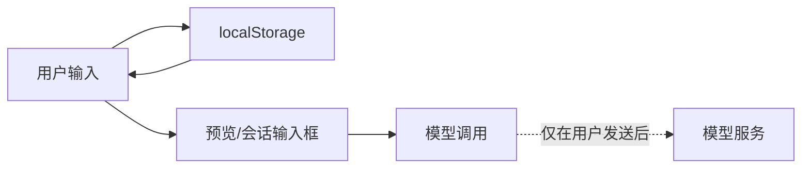

# 横切底座

> 这一层回答：**每个包都必须满足、但不属于某一个业务功能的东西。**
> 包括国际化、可访问性、主题、隐私、安全、持久化、可观测性、兼容性与供应链。
> 这些不是「以后再加」的装饰；它们是发布门槛。

## 1. 国际化（i18n）

### 1.1 文案分层

| 层 | 位置 | 例子 |
| --- | --- | --- |
| 包元数据 | `packages/*/locale/{zh,en}.json` | 插件标题、描述 |
| 面板 UI | `client.js` 内的 `zh` / `en` 字典 | 字段标签、按钮、状态、空状态 |
| Host 返回 | `index.js` 内的说明文本 | 「未找到 SKILL.md」 |
| 文档 | `README.md` / `README.en.md` / `docs/*` | 中文优先，英文概览 |

### 1.2 规则

- 每个用户可见字符串必须有 `zh` 与 `en` 两个 key；缺失时回退 key 本身。
- 插值统一 `{name}`，不做字符串拼接。
- 不在 JSX/模板里写死中文或英文。
- 新增 key 必须同时更新两个字典与渲染断言。
- 文案避免仅靠颜色/图标传达状态；状态必须有文字。

### 1.3 已知限制

- 详细文档目前中文优先；英文只覆盖 README 与代码内文案。
- 未做复数、RTL、日期/数字本地化；当前 UI 不需要。
- 长英文文案的视觉溢出没有自动截图测试。

## 2. 可访问性（a11y）

已落实：

- 所有输入都有 `<label>` 或 `aria-label`；字段动作是真实 `<button>`。
- 选择组使用 `aria-pressed` 表达选中态，而不是只改颜色。
- 路径状态用 `role="status"`，文字说明 `idle/checking/ok/missing`。
- `:focus-visible` 有 2px 品牌色焦点环；不全局移除 outline。
- 键盘：Tab 可达；`Ctrl/Cmd+Enter` 触发「填入新会话」。
- 装饰 SVG `aria-hidden="true"`；图标按钮有文字标签。
- `prefers-reduced-motion` 下移除过渡。
- 颜色使用主题 token；不把颜色作为唯一信息载体。

未证明：

- 未跑 axe/等价自动化；未做屏幕阅读器实测。
- 对比度依赖 DSH 主题；自定义 skin 可能不达标。
- 没有焦点陷阱/模态场景（当前面板无模态）。

## 3. 主题与视觉

- 所有 UI 颜色、边框、背景、状态色来自 `--dsw-alias-*`：`bg-base`、`bg-layer-1/2`、`label-primary/secondary`、`border-l1/l2`、`brand-primary`、`state-success/warn/idle`。
- 不写死 `#hex` / `rgb()` / `hsl()`；装饰性 SVG 可用自有调色板，但 `aria-hidden` 且不承载信息。
- 不覆盖 DSH 全局 token；只消费。
- 不缓存主题色；面板每次渲染用 CSS 变量，跟随 DSH 明暗切换。
- 已知风险：第三方 skin 若把 `bg-base` 设为深色，面板会跟随变深；这不是面板的独立主题。

规范细节见 [设计系统](design-system.md)。

## 4. 隐私与数据

### 4.1 数据流

- 面板**没有** `fetch`、XHR、WebSocket、遥测、远程日志。
- 表单只写浏览器 `localStorage`：`dsh.ppt-master.v1` / `dsh.ars.v1`。
- 用户把素材/研究对象填进表单时，内容会进入本地浏览器存储；发送后进入会话与模型调用。
- 本机仓库路径会进入 prompt；guide 工具只读该路径下的候选 `SKILL.md`，不扫描目录、不执行脚本。
- 不收集账号、设备指纹、使用统计。

### 4.2 用户须知

- 素材可能含敏感信息；请按所在机构/组织的数据政策处理。
- 「本机优先」不等于「永不出机器」：模型调用、用户启用的搜索/图像/语音服务仍可能接收内容。
- 清除 `localStorage` 对应键即可删除表单记忆。

## 5. 安全

| 面 | 措施 |
| --- | --- |
| XSS | 不用 `innerHTML`、`dangerouslySetInnerHTML`、`eval`、`new Function`；文本走 React 转义 |
| 路径输入 | 仅作为字符串传给 guide；Host 只 `open/read` 候选文件，不 `exec/spawn` |
| 文件读取 | 12,000 字符上限；有界前缀读取；缺失路径返回说明而非抛错 |
| 命令执行 | 不执行上游脚本、不调用 shell、不安装依赖 |
| 供应链 | 运行时零第三方依赖；测试只用 Node 内置；CI 使用官方 action |
| 密钥 | 仓库不含 token/私钥；契约测试扫描常见模式 |
| 权限 | 不需要额外权限；不请求沙箱升级 |
| 注入 | 用户素材进入 prompt 是预期行为；最终发送前由人审阅；面板不自动执行 |

**明确不做**：本项目不提供沙箱、不隔离上游 agent 的工具权限、不保证模型输出安全。上游执行的安全由 DSH 与用户环境负责。

## 6. 持久化

- 键：`dsh.ppt-master.v1` / `dsh.ars.v1`；版本后缀便于未来迁移。
- 读取时校验字段类型/枚举；损坏数据回退默认值并继续渲染。
- 写入 `try/catch`；隐私模式/配额满时静默降级，不阻塞使用。
- Host 无持久化；技能/工具注册由 DSH 生命周期管理。
- 未实现跨设备同步、导入/导出、迁移脚本；见 [ADR-0004](adr/0004-local-first-persistence.md)。

## 7. 可观测性

- 无遥测、无远程日志、无性能上报。
- UI 内可见反馈：复制成功/失败、路径 `idle/checking/ok/missing`、按钮 disabled 态。
- Host 工具以文本返回错误说明（缺失参数、路径不存在、文件不可读），不抛未捕获异常。
- 出问题时的人工排查路径：浏览器控制台 → DSH 插件行 → 包目录 → `SKILL.md` 路径。

这是有意的取舍：插件是本地工具，不应偷偷上报。代价是维护者无法远程看到失败率。

## 8. 兼容性

| 依赖 | 要求 | 说明 |
| --- | --- | --- |
| Node.js | ≥22 | Host 与测试；客户端由 DSH 提供运行时 |
| DSH | 支持 client bundle / `sidebar.panellist` / `main` / `uiWorkspace` / `tools` / `skills` | API 仍在演进；升级后需回归 |
| 浏览器 | 支持 CSS 变量、`localStorage`、`Intl` 基础能力 | 由 DSH Web 决定 |
| 上游 PPT Master | 本机 checkout；Python 3.10–3.14（真实生成时） | 面板不安装 |
| 上游 ARS | 本机 checkout；其 Claude Code 运行环境 | 面板不安装 |

不承诺向后兼容所有 DSH 版本；README 与 Release 会标注验证版本。

## 9. 性能与体积

- 两个 client 源码合计约 100 KB；无构建、无第三方运行时依赖。
- 首屏只做一次模块注册与一次渲染；无网络请求。
- 路径检查 500ms debounce；`listDirectory` 只调用一次。
- Host guide 读取上限 12,000 字符，防止大文件进入上下文。
- 未做低端机基准；未做大数据量表单性能测试。

## 10. 供应链与许可

- 运行时零依赖；`package.json` 不声明 `dependencies`。
- 根仓库 MIT；PPT 包 MIT；ARS 包 CC BY-NC 4.0；见 [ADR-0005](adr/0005-mixed-licensing.md)。
- 上游来源、版权、许可证全文见 [ATTRIBUTION.md](../ATTRIBUTION.md) 与 [NOTICE](../NOTICE)。
- 发布前检查：包级 `LICENSE`、根 `NOTICE`、README 许可表、`files` 字段包含许可证。

## 11. 横切红线

以下任一项不满足，不应发布：

- 出现 `fetch`/遥测/远程存储，而未在文档中明确说明并获用户同意。
- 出现 `eval`/`innerHTML`/动态代码执行。
- 把 ARS 包标成 MIT，或移除上游版权/许可。
- 声称「已验证实验/数据/可复现」。
- 把路径可读说成环境可执行。
- 自动发送 prompt，而不是放入输入框由人确认。
