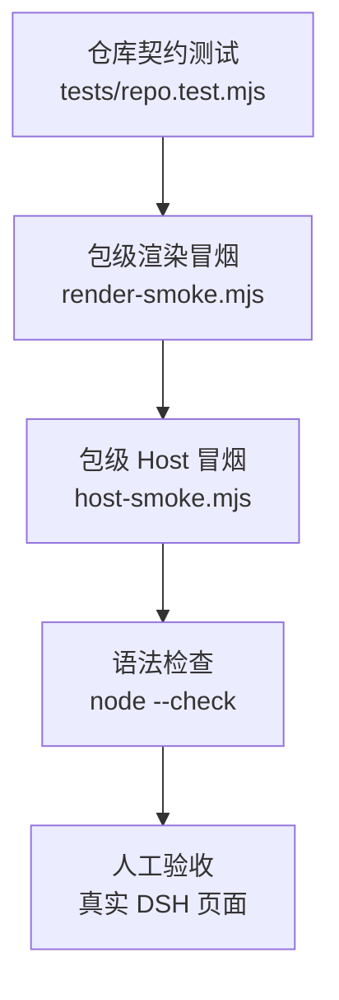

# 质量与测试层

> 这一层回答：**我们怎么知道它还能用、哪些东西没被证明。**
> 测试通过不等于产品正确；它只证明被断言的那部分契约。

## 1. 测试策略



| 层 | 目标 | 不替代 |
| --- | --- | --- |
| 仓库契约 | 两个包在结构、命名、schema、文案、许可上保持一致 | 真实加载 |
| 渲染冒烟 | `client.js` 能被模块加载器解析、`apply` 能注册、中文界面能渲染 | 浏览器布局与交互 |
| Host 冒烟 | 工具/技能能注册、guide 能读、缺失路径可解释、超长会截断 | 真实 agent 调用 |
| 语法检查 | 所有 JS 可解析 | 运行时行为 |
| 人工验收 | 真实 DSH 中安装、点击、填入新会话、刷新保留 | 自动化回归 |

## 2. 测试清单

### 2.1 仓库契约：`tests/repo.test.mjs`

不依赖 DSH，直接读文件与 VM 执行客户端模块。

| 断言组 | 内容 |
| --- | --- |
| 包清单 | 每个包存在；`name`、`version`、`license`、`private`、`type`、`engines.node`、`exports`、`files` 合法；`dsh.bundle.patch` 指向存在的文件 |
| Bundle patch | 每个 `cordis.patch.yml` 插入的 row id 与包名匹配；无重复 id |
| 模块 id | `client.js` 的 `__ModuleLoader__.load` id 等于包名 |
| Slot 契约 | 侧栏 id/order 唯一；`main` key 等于侧栏 id；`apply` 注册两个 slot |
| 双语 | `locale/zh.json` 与 `en.json` key 集合一致；面板字典 key 对齐；无空值 |
| 主题 | 客户端 CSS 不出现硬编码 UI 颜色（`#hex`、`rgb()`、`hsl()`），只允许 `--dsw-alias-*` 与透明值 |
| 危险 API | 客户端不出现 `document.body`、`innerHTML`、`fetch(`、`eval(`、`new Function` |
| Secrets | 不出现常见 token/私钥模式 |
| Host schema | 工具输出为对象层 `required: ['text']`；不得在属性层写 `required: true` |
| Prompt 红线 | PPT 含「不编造数据」「原生可编辑」；ARS 含「完整性闸门」「不编造引用」「人工确认」 |
| 许可 | 根 `LICENSE` 为 MIT；PPT 包含 Hugo He 版权；ARS 包含 CC BY-NC 4.0 与 Cheng-I Wu；`NOTICE`/`ATTRIBUTION` 存在 |
| 文档 | 五层文档、ADR、README 存在；相对链接可解析 |
| 历史残留 | 不出现旧的本地包前缀；扫描常见 token/私钥模式 |
| 图标 | 两个 `icon.svg` 可被 XML 解析 |

### 2.2 渲染冒烟：`test/render-smoke.mjs`

做法：

1. 用 `node:vm` 构造 `window.__ModuleLoader__`。
2. `require('react')` 返回一个最小 React 桩：`createElement`、`useState`、`useEffect`、`useMemo`、`useRef`、`useCallback`。
3. `ctx` 桩提供 `locale.register`、`slots.inject/register`、`uiWorkspace.startSession/listDirectory/pickDirectory`。
4. 调用 `apply(ctx)`，取出 `main` 注册的组件并渲染。
5. 递归收集文本节点，断言关键中文文案。

它能抓到：模块 id 错、语法错、`apply` 未注册、文案 key 缺失、渲染时抛错。

它抓不到：真实 React 并发行为、浏览器布局、CSS 实际生效、点击后的视觉反馈。

### 2.3 Host 冒烟：`test/host-smoke.mjs`

做法：

1. 创建临时目录，写入 `skills/<name>/SKILL.md`。
2. 动态 `import('../index.js')`。
3. 调用 `apply(ctx)`，捕获 `ctx.effect` 并执行。
4. 断言技能名、`source`、归因文本；工具名、schema、renderer。
5. 调用 renderer：有路径、空路径、缺失路径、13,000 字符超长文件。
6. 断言超长时含 `[truncated]` 且长度 ≤ 12,300；清理临时目录。

它能抓到：注册名错、schema 错、文件读取错、截断逻辑回归。

它抓不到：真实 DSH 工具调用协议、权限差异、并发调用、超长 UTF-8 边界。

### 2.4 语法检查

`node --check` 覆盖根 `scripts/`、`tests/`、两个包的 `index.js`/`client.js`/测试文件。它不执行代码，只证明可解析。

## 3. 运行方式

```bash
# 全部
npm test

# 只跑仓库契约
npm run test:repo

# 只跑某个包
npm test --workspace @dsh-research-studio/ppt-master

# 一键验证（契约 → 包测试 → 语法）
npm run verify
```

`npm test` 在根目录执行，Node.js **22+**。测试不需要网络、不需要安装 DSH、不需要上游仓库。

## 4. 确定性

- 每个 Host 测试使用独立临时目录，结束后删除。
- 不访问网络；不读用户真实仓库；不写用户 profile。
- 渲染测试用桩，不启动浏览器；不依赖系统主题。
- 断言基于文本与结构，不基于像素截图。

## 5. 覆盖缺口（明确不证明）

| 缺口 | 影响 | 计划 |
| --- | --- | --- |
| 浏览器级 E2E | 无法证明真实点击、焦点、布局、刷新保留 | P0；Playwright 或 DSH 自带 E2E |
| DSH 版本矩阵 | 只验证当前开发环境；API 漂移可能破坏 | 在 CI 中跑至少一个固定 DSH 版本 |
| 上游真实执行 | 不证明 PPTX 能生成、ARS 能跑完 | 需用户本机环境；不在 CI 中执行 |
| 可访问性自动化 | 只有语义结构与键盘路径的人工检查 | 加 axe 或等价检查 |
| 视觉回归 | 无截图基线；主题切换可能错位 | 加截图对比 |
| 性能 | 无大文件/低端机基准 | 记录渲染与路径检查耗时 |
| 安全 | 无渗透测试；只做静态模式扫描 | 威胁建模 + 依赖审计 |
| i18n 布局 | 英文长文案可能溢出 | 加英文渲染截图 |

**不要**把「`npm test` 通过」表述为「产品已全面验证」。准确表述是：**仓库契约、渲染冒烟、Host 冒烟与语法检查通过；浏览器 E2E 与上游执行未覆盖。**

## 6. 测试设计原则

1. **测契约，不测实现细节**：断言 id、schema、文案、行为结果，不断言内部函数名。
2. **每个 bug 一条回归**：例如 `required` 层级错误、超长截断、重复 key。
3. **测试要能失败**：新增断言先确认在旧代码上会红，再修。
4. **不 mock 掉被测对象**：Host 测试用真实 `index.js` 与真实文件；只桩 DSH 上下文。
5. **临时目录必须清理**：`try/finally`，避免污染工作区。
6. **不依赖顺序**：每个测试独立；共享常量只读。

## 7. CI 现状

`.github/workflows/ci.yml` 在 Node **22 / 24** 上运行 `npm test`，然后检查工作区没有意外改动：

```yaml
strategy:
  matrix:
    node: [22, 24]
steps:
  - uses: actions/checkout@v4
  - uses: actions/setup-node@v4
    with: { node-version: '${{ matrix.node }}' }
  - run: npm test
  - run: git diff --exit-code
```

CI 只做静态验证，不安装 DSH、不跑浏览器、不执行上游。真实页面验收仍需人工完成，记录见 [验收](acceptance.md)。

## 8. 人工验收清单

- [ ] 两个入口都出现，图标与标签正确。
- [ ] 切换面板不丢表单；刷新后表单保留。
- [ ] 预览随字段实时变化；复制成功/失败都有反馈。
- [ ] 「填入新会话」打开新会话，指令在输入框，未自动发送。
- [ ] 路径选择器能填入路径；错误路径显示 `missing`。
- [ ] 中英文切换后无缺失 key、无溢出。
- [ ] 浅色/深色主题下对比度可读。
- [ ] 键盘可达：Tab 顺序、焦点环、Ctrl/Cmd+Enter。
- [ ] 禁用/重新启用插件不产生重复注册错误。
- [ ] 上游缺失时，agent 按指令说明缺什么，而不是声称已执行。
